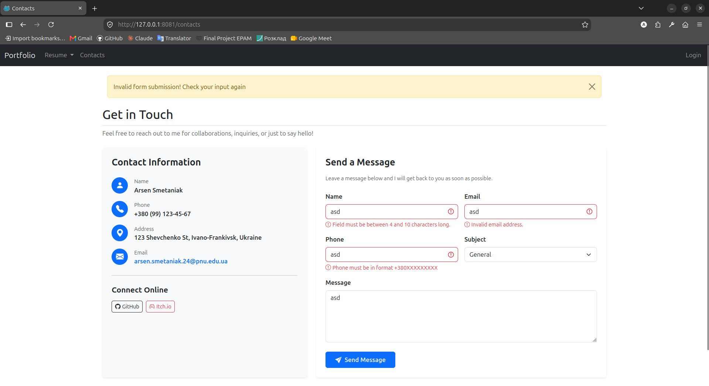
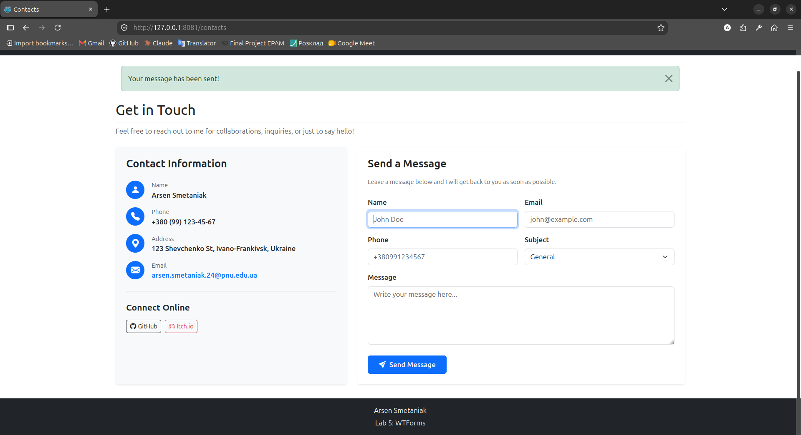
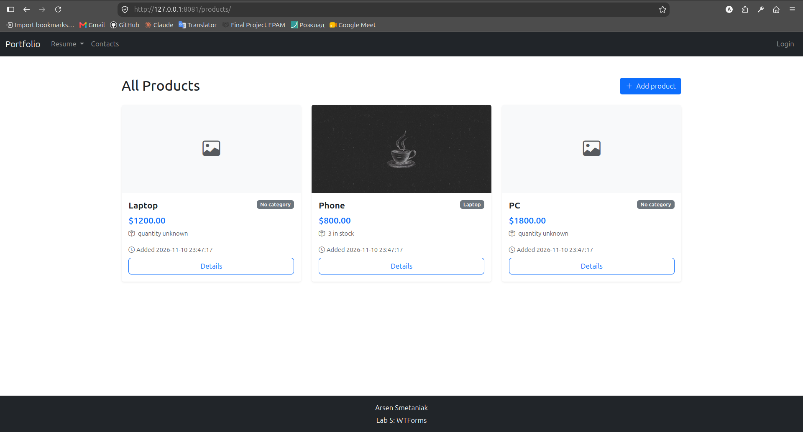
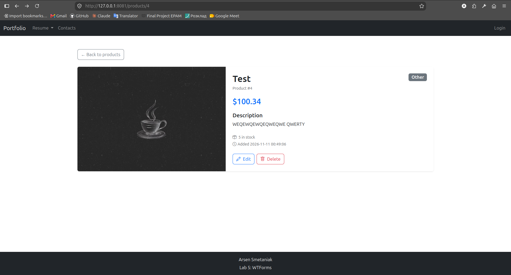
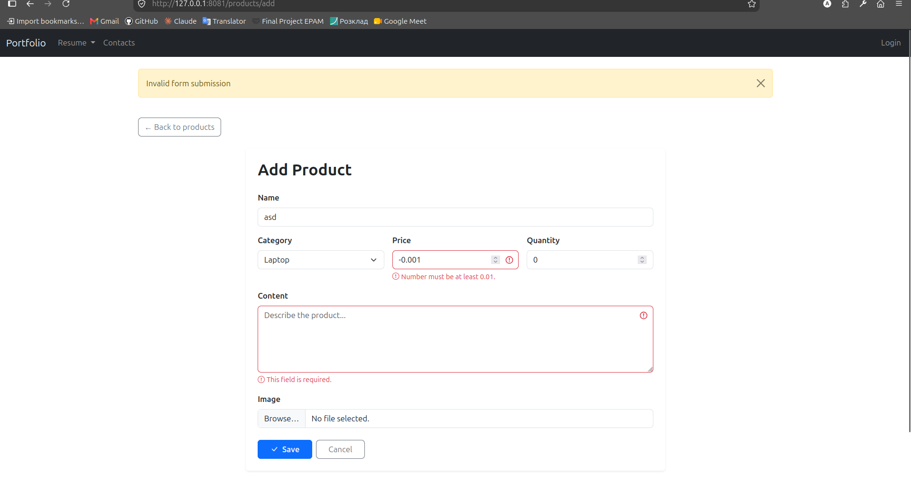
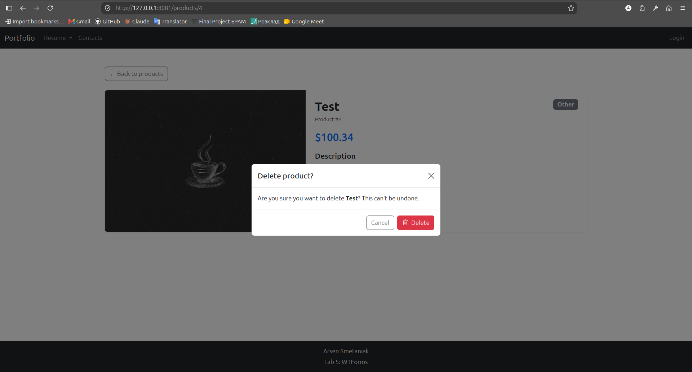

# Lab 5: WTForms

A Flask app with forms built on Flask-WTF. The contact form validates its fields, is protected from CSRF, writes every message to `logs/contacts.log` and follows the Post/Redirect/Get pattern. The `products` blueprint stores products in TinyDB (`data/products.json`) and supports adding, viewing, editing and deleting them, with image uploads saved to `app/products/static/uploads/`. All form fields are rendered with a shared macro that shows the field's errors, and every action shows a flash message.

## Screenshots

### Contact form validation

### Contact form submitted

### Products page

### Product page

### Product form validation

### Delete confirmation

