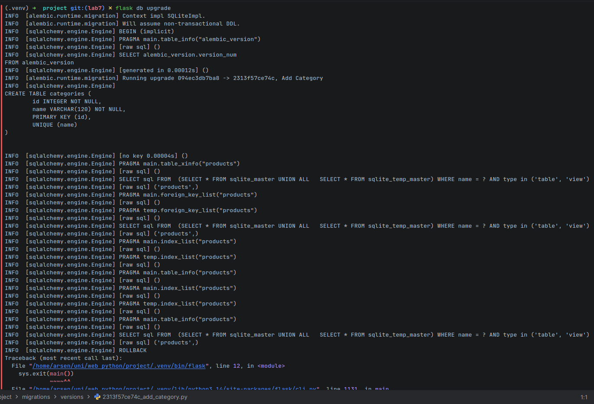
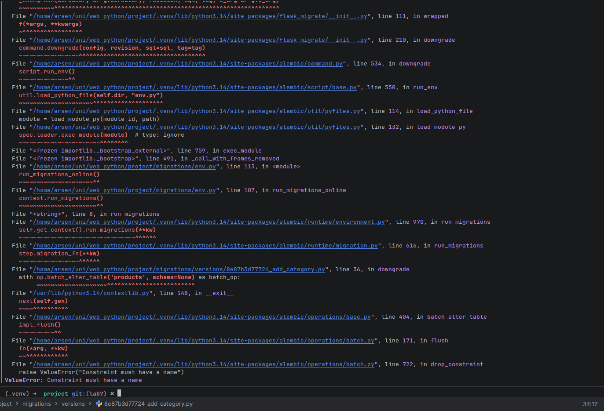
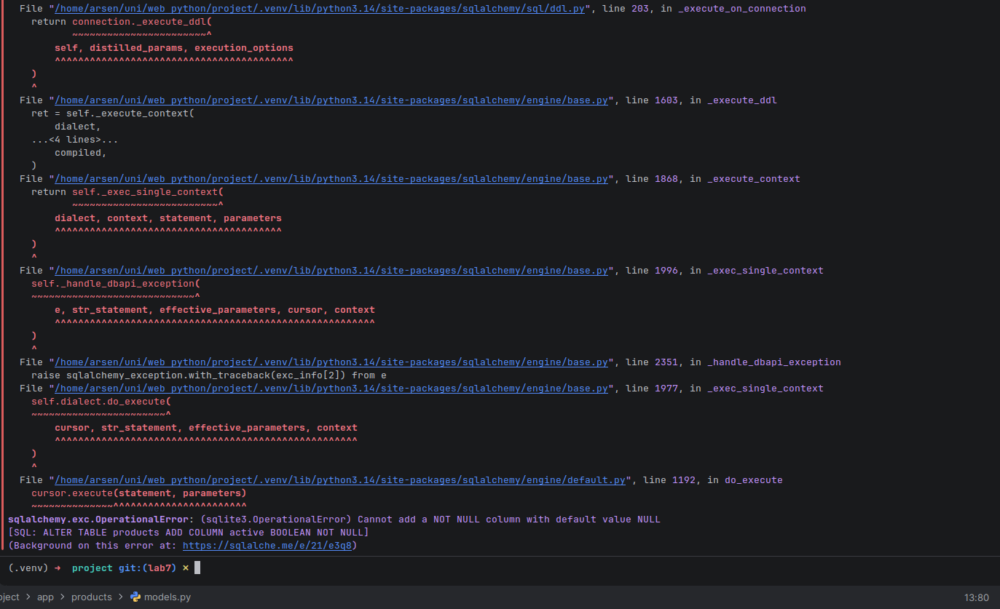
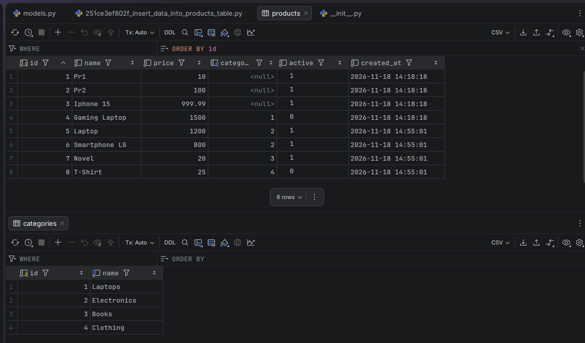
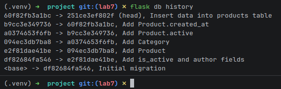

# Lab 7: Relationships. Migrations

## Screenshots

### `upgrade` fails: foreign key constraint has no name

### `downgrade` fails: dropped constraint has no name

### Adding a NOT NULL column without a server default

### Final data in `products` and `categories`

### Migration history

