# Lab 6: ORM. Introduction to SQLAlchemy. CRUD operations

## Screenshots

### Working with the database in Flask Shell
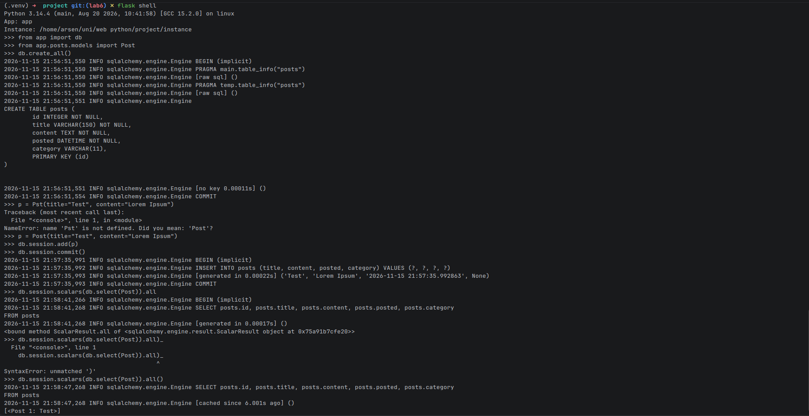

### Initialising migrations
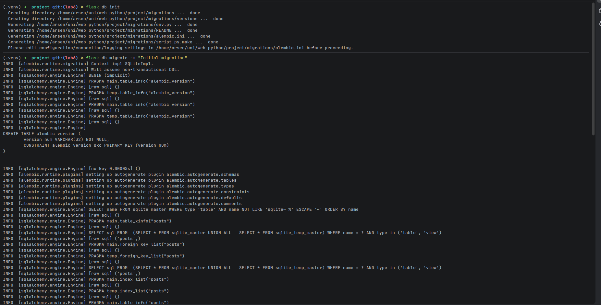

### Migrations folder
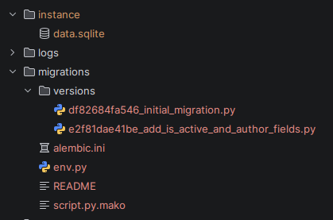

### Initial migration
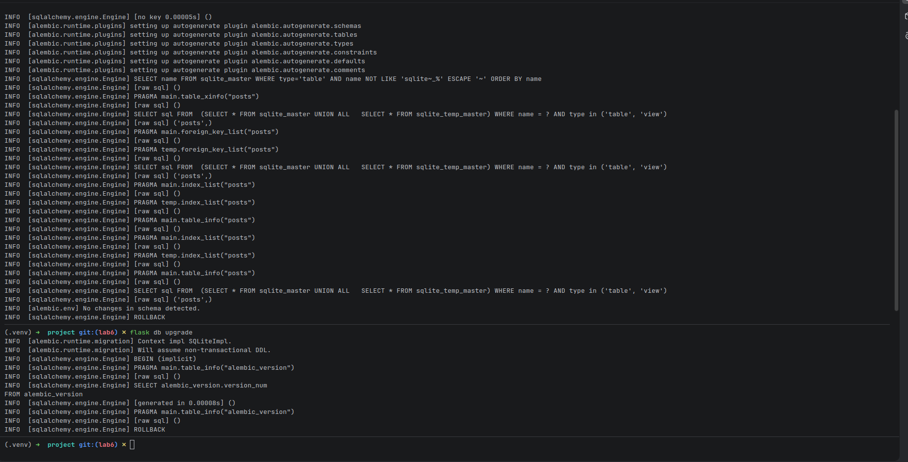

### Database schema after the initial migration
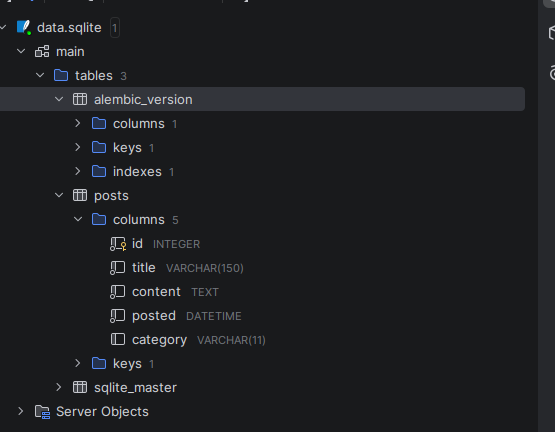

### Migration adding `is_active` and `author`
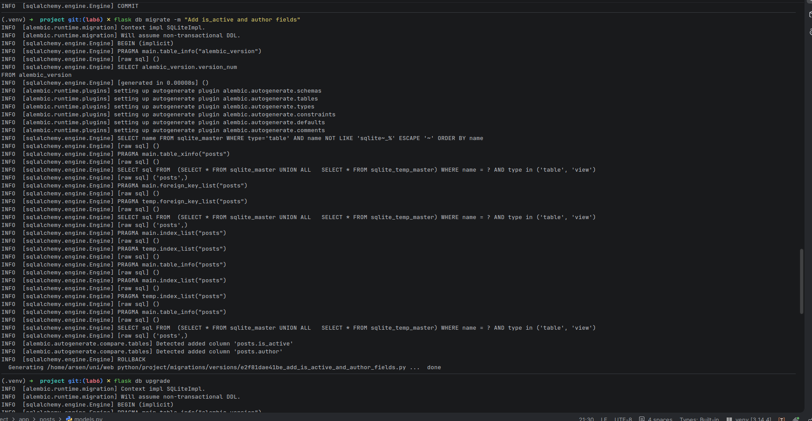

### Database schema after the second migration
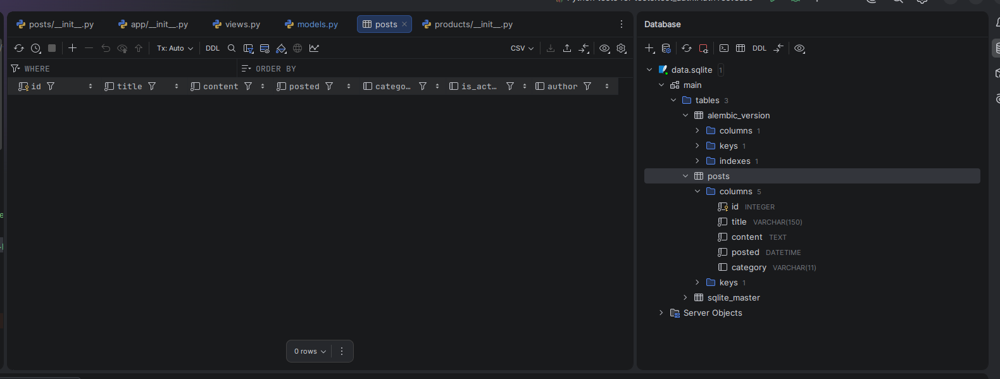

### All posts
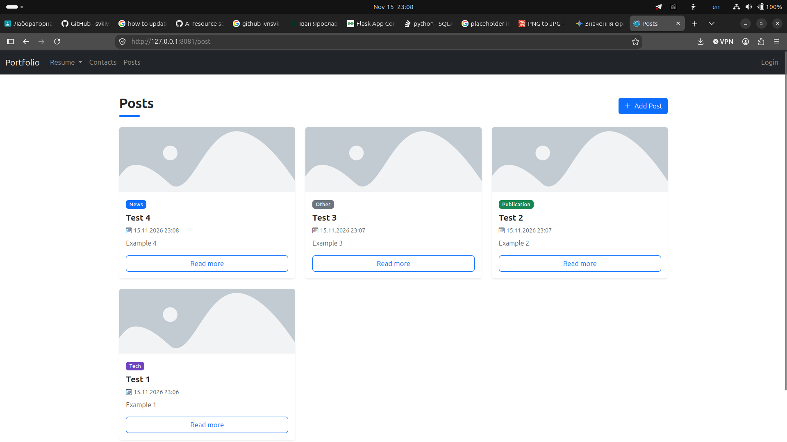

### Post page
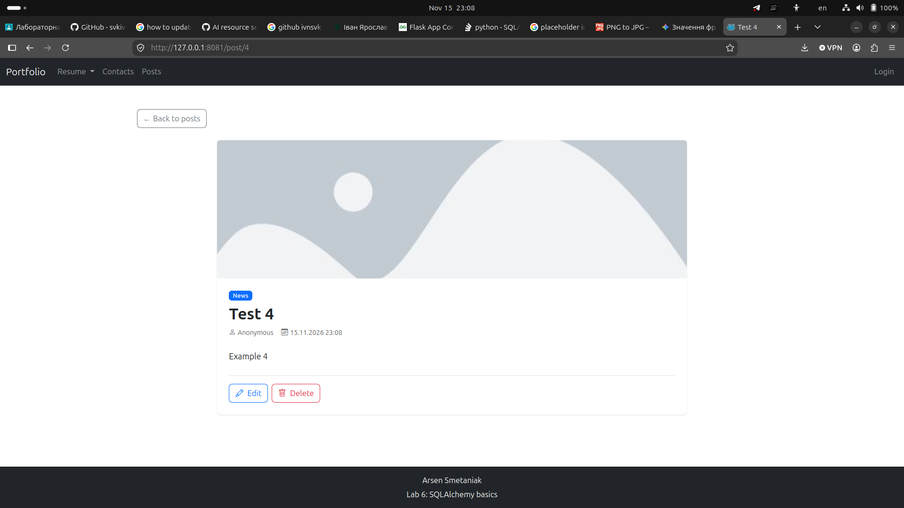

### Creating a post
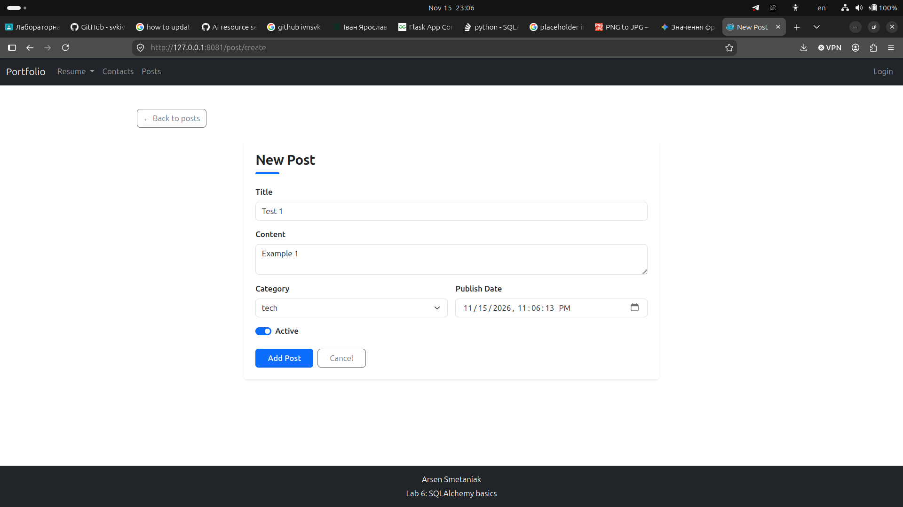

### Delete confirmation
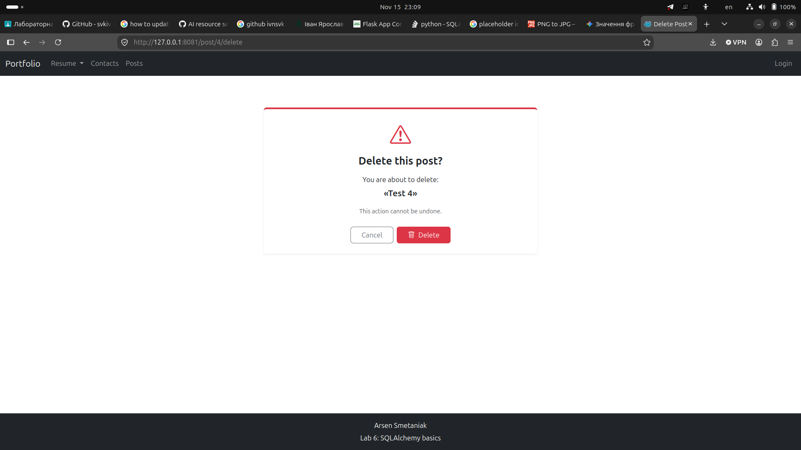

### Posts on the site and in the database
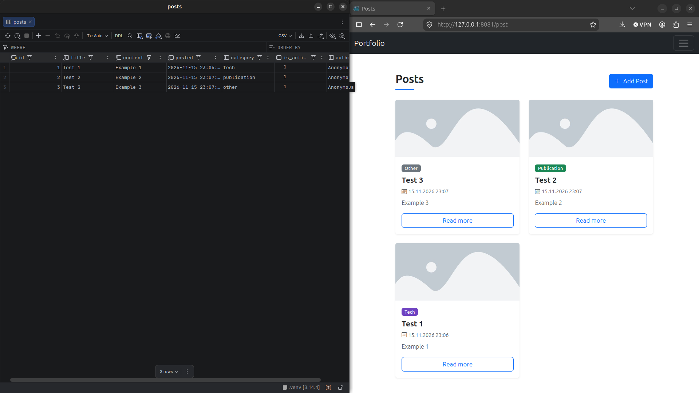

### Tests completion
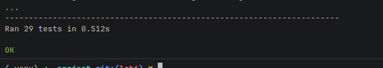