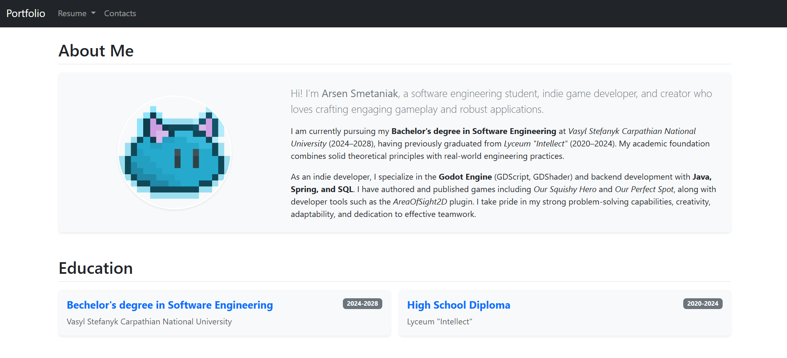
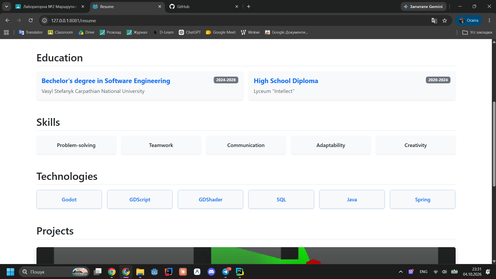
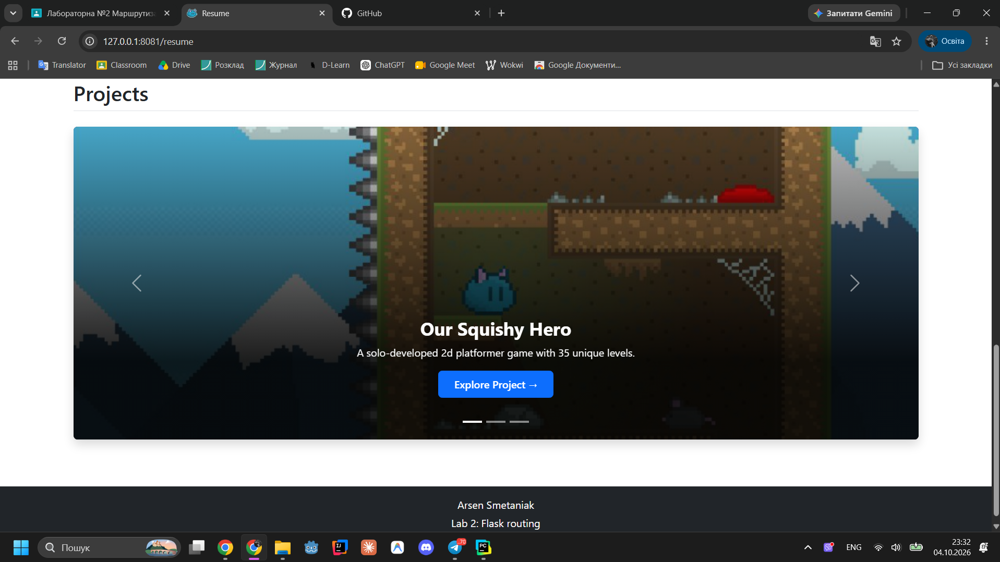
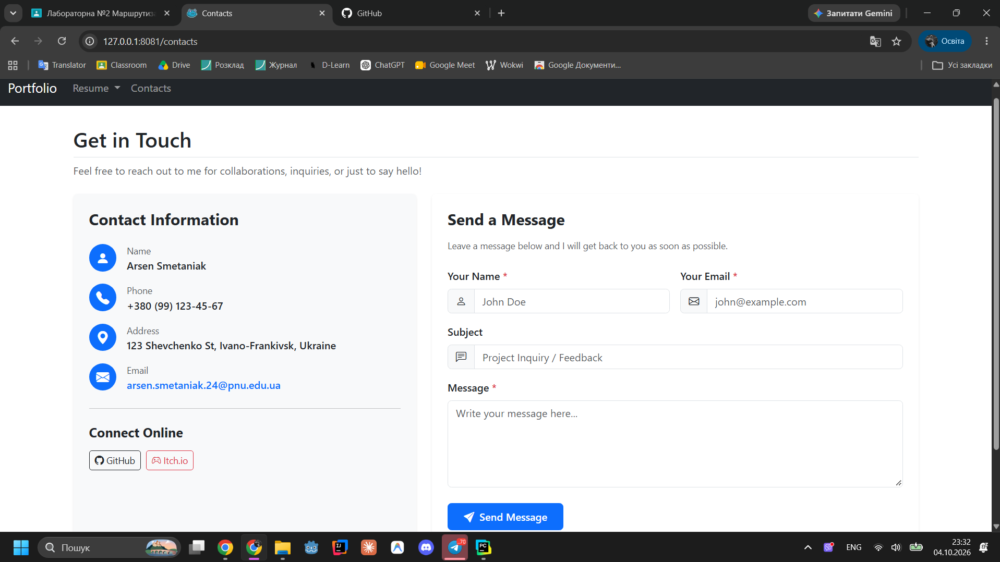

# Flask Portfolio & Resume Web App (Lab 2)
A small Flask web app with dynamic routing and Jinja2 template inheritance.

## Features
- Dynamic routing with `@app.route`
- Jinja2 template inheritance with blocks and includes
- Dynamic pages' content with Flask and Jinja2

## Screenshots
### Resume Page

### Contacts Page
