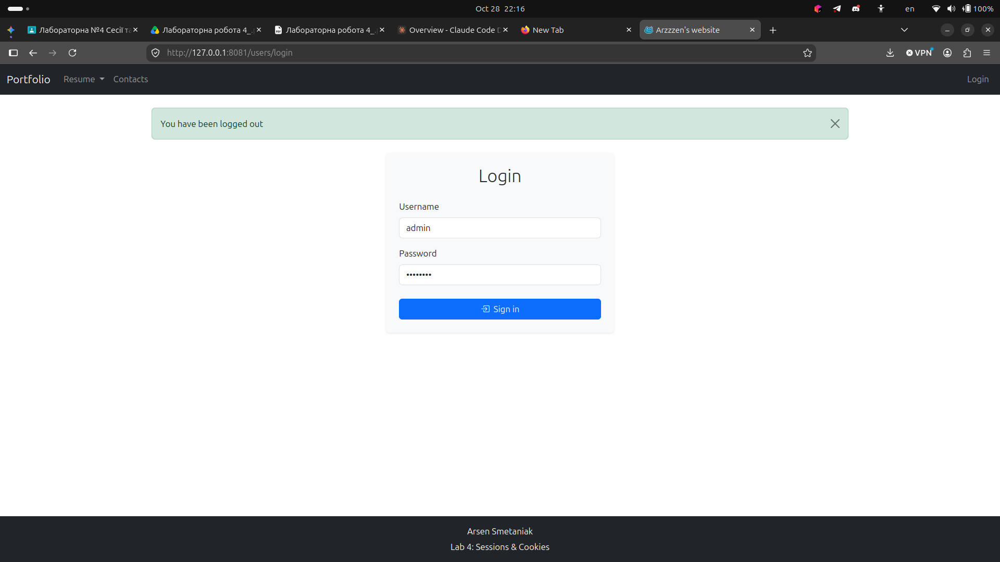
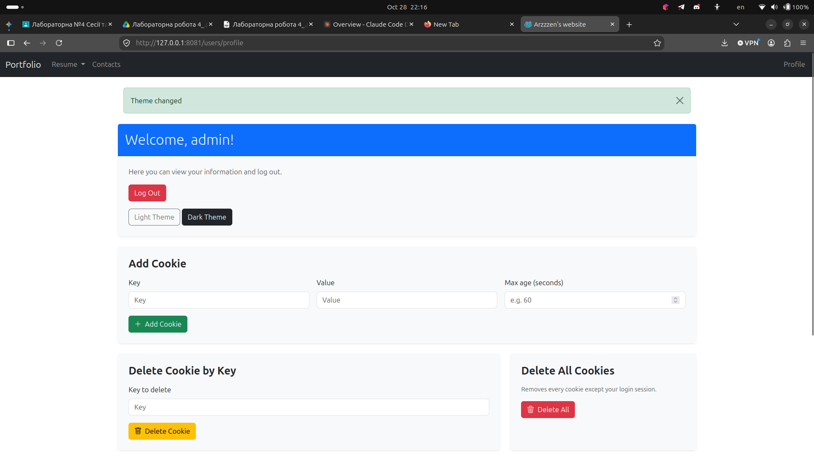
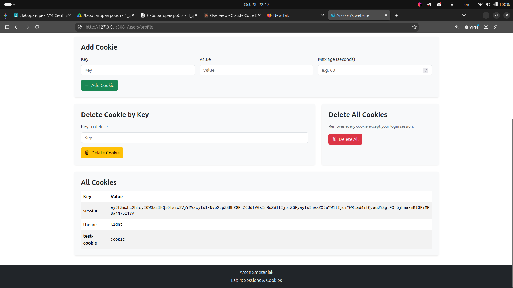
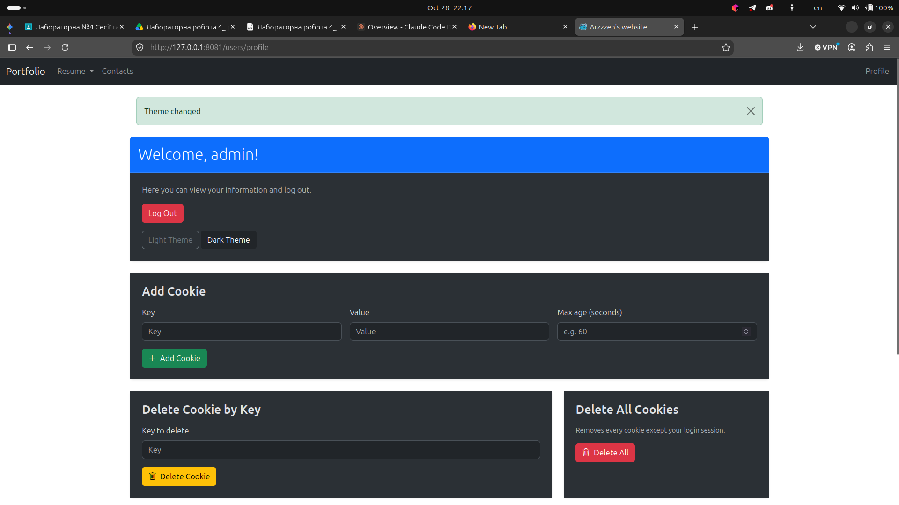

# Lab 4: Request object, sessions and cookies

A Flask app with session-based login, flash messages, cookie management and a color theme switcher. All of it lives in the `users` blueprint.

## Screenshots

### Login page

### Profile page

### Cookie management

### Theme switching

